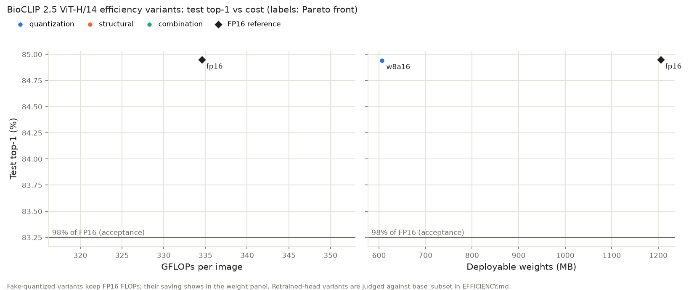

# Efficiency variants (BioCLIP 2.5 ViT-H/14 tower + production probe)

Generated by `python -m transferner.eval.efficiency_report` from `results/tables/efficiency.csv`. Accuracy is measured on recent regional photos (test 176,590 images); variants were selected on val. Δ is in points against the row's reference (`fp16`, or `base_subset` for retrained heads); rel = test top-1 / reference. Acceptance for partial W8A8: rel ≥ 0.98.

DMR = dangerous miss rate: share of test images of toxic species (contact / ingestion, from `data/traits/species_traits.csv`) predicted as a non-toxic species, without abstention. The trait table is still partial, so DMR covers only the species it lists.

Latency, memory and NPU compile need the phone; GPU img/s here is a ROCm proxy for float variants only.

| variant | family | ref | test top-1 | Δ pt | rel | test top-5 | val reg top-1 | val_ext top-1 | rare top-1 | agree ref | McNemar p | DMR contact | DMR ingest | weights MB | GFLOPs | GPU img/s |
|---|---|---|---|---|---|---|---|---|---|---|---|---|---|---|---|---|
| fp16 | reference | – | 84.95 | – | – | 96.45 | 90.03 | 48.89 | 57.98 | – | – | 5.46 | 4.41 | 1206 | 334.6 | 188 |
| w8a16 | quantization | fp16 | 84.94 | -0.01 | 0.9999 | 96.45 | 90.04 | 48.82 | 58.00 | 0.9946 | 7.4e-01 | 5.44 | 4.36 | 606 | 334.6 | – |

